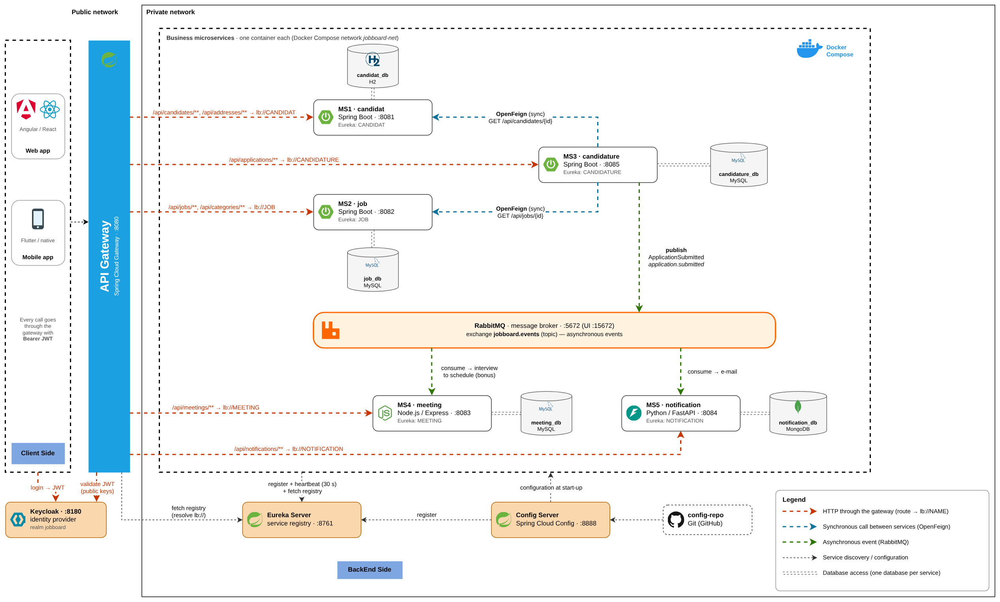

# Chapter 3 — Migrating to Microservices

**Distributed Web Architecture (AWD)** · ESPRIT School of Engineering · 4th-year Computer Engineering · 2026–2027

---

## Why this chapter?

In Chapter 2, JobBoard's business logic was exposed as a **REST API** and consumed by web, mobile and desktop clients.
The gamble paid off: traffic grew, new teams joined, new features were requested (interview scheduling, notifications).
But the back end is still **one block**: one project, one process, one database, one deployment.

**When, why and how should a monolith evolve into autonomous services?**

This chapter answers that question. It analyses the limitations of the monolith, defines what a microservice is,
decomposes JobBoard **by business domain** (DDD, Bounded Contexts) and selects a **progressive migration strategy**.

The chapter is **technology-agnostic**: it is about architectural decisions, not frameworks.
The infrastructure building blocks (Discovery, Gateway, communication, security, containers) are implemented in the following chapters.

---

## Video lectures

▶ [Microservices architecture](https://youtu.be/iTa7LFezcSU) ·
▶ [From monolith to microservices](https://youtu.be/4rhzdZIDX_k) ·
▶ [The Strangler Fig pattern](https://youtu.be/BJiFd2KjRYs)

---

## Learning outcomes

By the end of this chapter, students will be able to:

1. **Explain** the motivations for migrating and distinguish genuine symptoms from mere trends.
2. **Identify** the limitations of the monolith: deployment, resilience, scalability and teamwork.
3. **Define** a microservice in terms of autonomy, loose coupling and business responsibility.
4. **Apply** the fundamental principles: Database-per-Service, explicit contracts, independent deployment.
5. **Decompose** JobBoard by business domain using DDD and Bounded Contexts.
6. **Compare** synchronous and asynchronous communication according to the business scenario.
7. **Assess** the challenges of distribution: data, network, security, observability and operations.
8. **Select** a progressive migration strategy, notably the Strangler Fig pattern.

---

## What this chapter covers

| # | Section | Key ideas |
| --- | --- | --- |
| 1 | Why migrate? | Hidden couplings, six limitations of the monolith, *Monolith First* |
| 2 | Microservices | Definitions (Lewis & Fowler, Newman), anatomy of a service, monolith vs microservices |
| 3 | Fundamental principles | Six principles, Conway's law, Database-per-Service, scale cube |
| 4 | Decomposing by domain | Business vs layers, DDD, subdomains, Bounded Context, context map |
| 5 | Target architecture | API Gateway, Service Discovery, Config Server, broker, sync vs async |
| 6 | The challenges | Partial failures, distributed data, Saga, observability, security |
| 7 | Migration strategies | Big Bang vs incremental, Strangler Fig, Branch by Abstraction, database decomposition |

---

## JobBoard as microservices: the target architecture

### From one domain to six services

**Recruitment** is the domain. Each business subdomain becomes a Bounded Context, and each context a candidate microservice
with **its own database**.

| Service | Business responsibility | Subdomain type |
| --- | --- | --- |
| **Candidate** | Candidate profiles, CVs, skills | Supporting |
| **Company** | Companies, recruitment agencies, recruiters | Supporting |
| **Job** | Publishing and searching job offers | Core / supporting *(open to debate)* |
| **Application** | Application lifecycle, from submission to hiring decision | Core |
| **Meeting** | Interview scheduling between recruiters and candidates | Supporting |
| **Notification** | Email, SMS and push messages at each stage | Generic |

### Cross-cutting components

| Component | Role |
| --- | --- |
| **API Gateway** | Single entry point: routes each request to the right service, centralises authentication |
| **Service Discovery** | Registry of active instances; services find each other by name, not by IP |
| **Config Server** | Centralised configuration per service and per environment |
| **Message broker** | Carries business events between services (asynchronous) |
| **Identity provider** | Issues the tokens verified at the gateway and by the services |

### How services talk

- **Synchronous (REST)** when the caller needs the answer to continue — e.g. *Application → Job*: is this offer still open?
- **Asynchronous (events)** to announce a fact — e.g. *Application* publishes "application status changed";
  *Notification* informs the candidate and *Meeting* proposes an interview slot. A slow mail server never blocks an application.

> **Rule of thumb:** one Bounded Context ≈ one microservice ≈ one database. No service reads another service's tables.

---

## Prosit 2 — JobBoard: from a monolithic backend to microservices

Teams start from the Spring Boot back end explored in Workshop 1 and, **without writing code**:

- diagnose the limitations of the monolith, each supported by evidence (code, contract, observed behaviour);
- map the domain: subdomains and their type (core, supporting, generic), with justification;
- delineate the Bounded Contexts and draw the **context map**;
- derive the list of microservices: responsibilities, database, REST resources, events published and consumed;
- draw the target architecture and justify the migration order.

Deliverables: a **design report** and a **presentation**. There is no single correct decomposition —
the design is assessed on the quality of its justification.

---

## Resources in this branch

| Resource | Description |
| --- | --- |
| `documentation/` | Architecture documentation of the JobBoard microservices back end |
| `documentation/diagrams/1-architecture-microservices.png` | Target technical architecture |

Course slides, interactive module (SCORM), Prosit 2 brief and quizzes: on the ESPRIT Blackboard space of the module.

---

## Previous and next

- ⬅ [Chapter 2 — Web Services and REST APIs](https://github.com/badi3a/AWD-Training/tree/Chapter_02)
  · video: [Web Services & REST APIs](https://youtu.be/T0TmRpyaGoE)
- 🏠 [Module home page (main branch)](https://github.com/badi3a/AWD-Training)
- ➡ Chapter 4 — Service Discovery and observability *(coming soon)*

---

## Main references

- J. Lewis & M. Fowler, *Microservices*, martinfowler.com, 2014.
- S. Newman, *Building Microservices*, 2nd ed., O'Reilly, 2021 · *Monolith to Microservices*, O'Reilly, 2019.
- C. Richardson, *Microservices Patterns*, Manning, 2018 · microservices.io.
- E. Evans, *Domain-Driven Design*, Addison-Wesley, 2003 · V. Vernon, *Domain-Driven Design Distilled*, Addison-Wesley, 2016.
- M. Fowler, *StranglerFigApplication* (2004) · *MonolithFirst* (2015) · *BoundedContext* (2014), martinfowler.com.

---

## Instructor

<table>
  <tr>
    <td width="140" align="center" valign="top">
      
    </td>
    <td valign="top">
      <h3>Dr. Badia Bouhdid</h3>
      

        Lecturer at <b>ESPRIT School of Engineering</b>, in charge of the
        <b>Distributed Web Architecture (AWD)</b> module for 4th-year Computer Engineering students.
      

      

        Teaching focus: software architecture, distributed systems, REST APIs and microservices,
        through problem-based learning and a single running example, <b>JobBoard</b>.
      

      

        
        
        
      

    </td>
  </tr>
</table>

Enjoy the journey into distributed systems.

